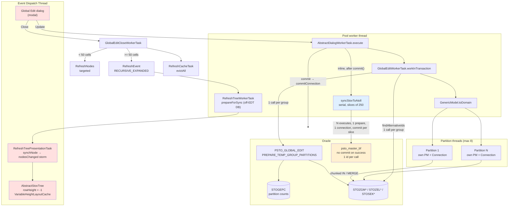
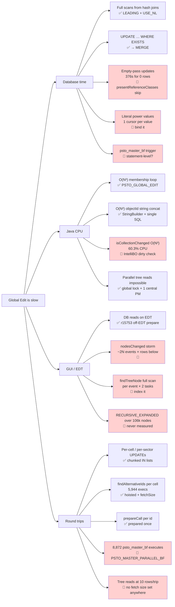

# STOV Global Edit — Performance Work Handover

**Status as of:** 26 Aug 2026
**Branch:** `stov/branches/STOV9102RC1_CommScope_Repeater_CR_And_SPL`
**Working copy:** `C:\pratik\Java\branches\STOV9102RC1_CommScope_Repeater_CR_And_SPL`
**Last committed revision:** r15759
**Uncommitted:** 2 files (see [Current State](#5-current-state))

This document is the single place to resume from. It records every change made, every
option rejected and why, every measurement taken, and every bug still open.

> **The GUI tree work has moved to its own document.**
> [`gui-tree-performance-handover.md`](./gui-tree-performance-handover.md) covers tree
> loading, the viewport-limited refresh, scroll lag, JDBC row prefetch and the
> `TreeUtils.findTreeNode` findings. It **supersedes Phase 7 and open items 6, 7 and 9
> below**, which are left in place for the reasoning they record.

---

## 1. System context

| Layer | Technology | Notes |
|---|---|---|
| UI | Java Swing, custom task framework | `ApplicationContainer` + `TaskAgenda`; worker tasks vs presentation tasks |
| Persistence | JDO via **IntelliBO** | Snapshot-based dirty checking; `PersistenceManager` is **not** thread-safe |
| Database | Oracle | Schemas `STOSM_O` (used), also `STO1M_O`, `STO2M_O`, `STOCM_O`; app connects as `STOV_HOTLINE_SM` |
| Profiling | JDK 8, JFR + HPROF | No `jfr` CLI available — custom parsers written (see [§10](#10-tooling)) |

**The feature under work:** the Global Edit dialog applies attribute changes (power
limits, rack/feeder/TMA types, planning status, carrier aggregation, …) to every cell
in one or more cell groups. Group sizes in production range from a handful to ~100k
cells; the cases exercised here were 4, 45, 604, 23k, 27,933 and ~35k cells.

### Key classes

| Class | Role |
|---|---|
| `GlobalEditWorkerTask` | Orchestrates the edit. Runs on a **pool worker thread**, not the EDT |
| `GenericModel` | Extracts dialog values, drives partitioned parallel execution |
| `AbstractGlobalEditBuldUpdate` | Calls each bulk-update command per cell group |
| `AbstractGlobalEditSQLBulkUpdateCommand` | Builds and executes the actual SQL |
| `QueryDefinition` | Static SQL strings |
| `GlobalEditUpdateCount` | Per-class update counters, reported to the user |
| `GlobalEditCloseWorkerTask` | Tree refresh + cache evict, on **dialog close** |
| `DynamicTreeListener` | Tree refresh: off-EDT prepare + on-EDT model mutation |
| `AbstractStovTree` | `setRowHeight(-1)` → `VariableHeightLayoutCache` |
| `DefaultTreeNodeAdapter` | Tree node cache (`getCachedName/Icon/Children`, `invalidate`) |
| `AbstractDialogWorkerTask` | Dialog transaction envelope + Atoll sync |
| `AbstractWorkspaceWorkerTask` | `getConnection` / `commitConnection` / `rollbackConnection` |
| `AtollDatabaseDAOImpl` | Calls `psto_master_bf` |
| `PSTO_GLOBAL_EDIT` (PL/SQL) | Set-based temp group creation and partitioning |

---

## 2. Chronological narrative

### Phase 1 — SQL and index tuning (→ r15754)

**Symptoms:** 4-cell update ~15s. Expanding 2 cells ~5s. Fetching 34,660 cells took
15.675s of which 15.665s was connection time.

`EXPLAIN PLAN` showed **full table scans on `STOALT` and `STOREPG`** even though the
join columns were fully covered by indexes. Cause: Oracle chose hash joins, and a hash
join wants to full-scan the build side; index access only pays off under nested loops.

**Changes:** added `LEADING(zg zt z s a)` + `USE_NL(zt z s a)` hints so the plan is
driven from the temporary group (lowest cardinality) outward, and converted
`UPDATE … WHERE EXISTS` to `MERGE … USING` for the power statements.

Also found empty-string bind values (`zg.ver_nr = ''`) wrecking cardinality estimates —
use real literals or binds.

> **Tradeoff:** hints pin the plan. They fix today's cardinalities but freeze the
> optimizer's choice; if group sizes or table volumes shift substantially these need
> revisiting. Accepted because the correct join order here is structural (temp group is
> always the smallest driver), not data-dependent.

### Phase 2 — The O(N²) membership loop (largest single freeze)

`GlobalEditWorkerTask` built the temporary cell group by adding cells **one at a time**,
and for each cell re-aggregated the entire group's cells into a `Set` to test membership.
Quadratic in group size, and each iteration also triggered lazy loads.

**Options considered:**

| Option | Verdict |
|---|---|
| Fix in Java — build the `HashSet` once outside the loop | Removes the O(N²) but leaves N round trips |
| Oracle **global temporary table** as a staging area | Rejected — adds a hop; the app already models temporary `CellGroup`s, so we can insert straight into the real member tables |
| **PL/SQL procedure doing a set-based insert** | **Chosen** |

Created package **`PSTO_GLOBAL_EDIT`** with `PREPARE_TEMP_GROUP` / `CLEAR_TEMP_GROUP`
(source: `c:\apps\cursor-code\sql\global_edit_temp_group.sql`).

**Result:** 45 cells in under 20 seconds.

**Problems hit and resolved:**

- **`ORA-04068: existing package state was canceled`** after recompiling. Cause:
  package-level variables. Fix: made the package **stateless** — variables became
  functions building their lists on demand. Also requires a client restart after redeploy.
- **Privileges.** Package lives in `STOSM_O`, app runs as `STOV_HOTLINE_SM`. Needed an
  execute grant plus a synonym. Alternative considered: `AUTHID CURRENT_USER` with
  grants on the underlying tables — rejected as more grants to maintain.
- **`TempGroupForRolesFetchInGlobalEdit` showed 0 rows in SQL Developer.** Not a bug —
  read-committed isolation; the rows were uncommitted in the application's session.
- **"The given Role do not have permission for changing data. Count of read only
  Cell/s are 5."** Initially suspected a fragile `LEFT JOIN`. Actually a role/data
  configuration issue: `STORPM.RPM_ALT_STATUS` values vs `STOPLS` ids, and the login
  role lacking `RPM_PERMISSION = 1` for those planning statuses. Not a code defect.

### Phase 3 — Collapsing per-cell and per-sector SQL

Many update paths issued one statement per cell or per sector. Worked through them
individually, converting each to a single chunked `IN (…)` statement, a `MERGE`, or a
JDBC batch, without changing the surrounding counting logic.

| # | Method (approx. line) | Change | Status |
|---|---|---|---|
| 1 | `executeRackTypeSQl` (1722) | per-sector UPDATE → chunked `IN` list | ✅ |
| 2 | `executeFeederSQl` (1855) | per-sector UPDATE → `IN` list; cached per-cell `vsto_lcmfet` lookup | ✅ |
| 3 | `executeJumperTypeAntennaSQl` (1994) | per-sector UPDATE → `IN` list | ✅ |
| 4 | `executeJumperTypeTMASQl` (2129) | per-sector UPDATE → `IN` list | ✅ |
| 5 | `executeCombinerTypeSQl` (2263) | per-sector UPDATE → `IN` list | ✅ |
| 6 | `executeTMASQl` (2402) | per-sector UPDATE → `IN` list | ✅ |
| 7 | `applyCarrierAggregation` (1204) | `addBatch` / `executeBatch`, single commit | ✅ |
| 8 | `updateAtollFrequencyName` (1433) | single `UPDATE … WHERE zel_id IN (…)` | ✅ |
| 9 | `executeRRHSQl` (1590) | cached `findPortNumberForPhysicalRemoteUnit` lookups | ✅ |
| 10 | `executePlanningStatusSQl` (1485) | single set-based UPDATE (alternative tab only) | 🔴 **in progress** |
| 11 | `executeMaxOverAllPower` | chunked `IN` list | ✅ |

**Bug found in `executeMaxOverAllPower`:** the dialog's `power` value was being mutated
*inside* the per-cell loop, so capping compounded across cells. Fixed with a local
`cellPower` variable. A follow-up null check was added because `Math.min` was receiving
a possibly-null power.

Housekeeping in the same area: removed stray `connection.commit()` calls, added
`throw new FatalSystemException(e)` after `connection.rollback()`, and (temporarily)
wrapped `logUpdate` in `synchronized (vr)` — later removed once counting was centralised.

> **Major tradeoff — DTOs + JDO bulk operations, rejected.** The proposal was to
> populate DTOs, derive the counts, then set values on persistent objects inside a
> transaction and let JDO handle the bulk write. Rejected: IntelliBO uses snapshot-based
> dirty checking, and `StateServiceImpl.isCollectionChanged` is O(N²) over collection
> membership (`ArrayList.contains` + `LTEPlainCellImpl.equals`, with internal locking).
> Later measured at **60.3% of CPU** during commit for a 28k-cell collection. Routing
> tens of thousands of objects through JDO is therefore strictly worse than direct SQL.
> Direct SQL + explicit cache eviction is the right model for this workload.

### Phase 4 — Parallel partitioning (→ r15755, r15756)

Idea (user's): the temporary group is already physical, so split it into several
logical groups with random UUID ids and process them concurrently — the architecture
already handles multiple groups.

**Concurrency model settled on:** one `PersistenceManager` **and** one `Connection` per
thread. `PersistenceManager` is not thread-safe, so sharing one is not an option.
`javax.jdo.option.Multithreaded` and `PersistenceManagerFactoryUtils` were discussed;
per-thread PM is the correct and simplest model here.

**Partition key — evolved:**

| Approach | Verdict |
|---|---|
| Round robin over cells | Rejected — splits a cell compound across partitions |
| **Cell compound (`ZVB_ID`)** | **Chosen** — compounds must be treated atomically, and production statistics show a user rarely touches more than ~100 cells in one compound |

**Implementation:** `STOGEPC` table holds partition counts;
`PREPARE_TEMP_GROUP_PARTITIONS` creates the partition groups;
`CLEAR_TEMP_GROUPS_BY_PREFIX` cleans them up. Temp group id is a UUID hex string; the
`STOZGR` rows get a `_P` + two-digit suffix per partition.

**`ORA-12838: cannot read/modify an object after modifying it in parallel`** —
caused by `ALTER SESSION ENABLE PARALLEL DML`. Resolution: use **parallel query with
serial DML** instead of parallel DML.

**r15755 review findings, all fixed:** unhandled `InterruptedException` /
`ExecutionException`, temp-group cleanup not in a `finally`, unsynchronised
`ValidationResult` updates, and an array index out-of-bounds in
`AssociateSectorWorkerTask`.

**r15756 — global update counting.** Each thread had its own `GlobalEditUpdateCount`
(good) but each logged its own line (bad). Added `GlobalEditUpdateCount.mergeFrom(…)`;
`AbstractGlobalEditBuldUpdate` now retains the counter and exposes `getUpdateCounter()`;
`GenericModel.PartitionResult` carries it; `toDomain` merges across partitions and calls
`logUpdate` **once**. `lastAddedUpdateCount` is deliberately not merged.

**`MAX_PARALLEL_PARTITIONS` history:** `4` → `availableProcessors()` (r15757) →
`Math.max(1, Math.min(8, availableProcessors()))` (r15758). Each partition is a
PM, i.e. an Oracle session; on a 32-core client an uncapped value opens 32 sessions per
user per edit. Note also that Java 8 before 8u191 ignores container CPU limits.

### Phase 5 — JFR and heap analysis

No `jfr` CLI on JDK 8, so custom parsers were written against
`oracle.jrockit.jfr.parser` (see [§10](#10-tooling)).

**First capture was useless** — it recorded an idle application, not the slow operation.

**Second capture** (27,933 cells, three power updates), ~529s recording, ~368s actual run:

| Phase | Time | Notes |
|---|---|---|
| Waiting on DB | ~158s | |
| Java cell loop | ~120s | Mostly sub-20ms I/O, **invisible to JFR** (socket read threshold is 20ms) |
| JDO commit dirty checking | ~80s | `StateServiceImpl.isCollectionChanged`, 60.3% CPU |

**Heap (246MB dump):** 212,394 `DefaultMutableTreeNode`, 106,201 `TreeStateNode`, plus
`VariableHeightLayoutCache` — a large GUI footprint that matters for [Phase 6](#phase-6--where-the-tree-refresh-actually-is).

**Second Java hotspot found:** `GlobalEditWorkerTask` lines 342–378 —
`objectId.contains(…)` plus string concatenation onto a growing string, giving billions
of character comparisons and repeated large reallocations, *and* N+1 lazy loads via
`getSector()` / `getAlternative()` / `getVersion()`.

> **Analysis errors made and corrected — read this before trusting old numbers:**
> - An early claim of "370s Java post-processing" was wrong: sample-count arithmetic
>   plus unaccounted idle time in the recording. Corrected by building `JfrPhase` to
>   produce a real wall-clock timeline.
> - `v$sqlarea` is **cumulative since the statement entered the shared pool**. An
>   execution count of 424,535 did not belong to a single run. Use the snapshot query
>   in [§10](#10-tooling) to measure per-run.
> - Per-cell ratios derived by dividing cumulative counts by cell count were misleading
>   and were withdrawn.
> - **`psto_master_bf` was wrongly believed to commit internally on every path.** Four
>   conclusions were drawn from it and all four were wrong; see the correction box in
>   [Phase 10](#phase-10--connection-lifecycle-and-the-atoll-sync). Lesson: the three
>   `COMMIT` statements were found by text search, and their *context* — two exception
>   handlers and an unroutable-length guard — was not checked.

### Phase 6 — Where the tree refresh actually is

**It is not in `GlobalEditWorkerTask`.** That task ends with dialog-local work only
(`resetCurrentTab`, `updateToGui`) and returns `LEAVE_OPEN`.

The refresh lives in **`GlobalEditCloseWorkerTask` lines 73–90**, queued by
`GlobalEditDialogEditController.rollback()` line 44 — i.e. on **dialog close**, not on
Update. It's wired to `rollback` rather than `commit` because the worker commits its own
transaction, so dismissing the dialog takes the rollback path.

- `< 50` cells → targeted `RefreshNodes.generateRefreshEventsNoSelection` driven by
  `GlobalEditDialogModel.getRefreshNodes()` (itself an N+1 loop, bounded at 50)
- `>= 50` cells → full `RefreshEvent(workspace, RECURSIVE_EXPANDED)` + `RefreshCacheTask`

**Consequence for the profiling:** the JFR capture had the modal dialog still open
(`AWT-EventQueue-0` inside `Dialog.show()`), so the refresh never ran during the
recording. Swing was only 1.9% of samples. **The tree-refresh cost is additional to the
368s and has never been measured.**

**What r15753 already fixed:** `DynamicTreeListener.refresh` splits into
`RefreshTreeWorkerTask` (off-EDT `prepareForSync`: `invalidate(true)` + re-read children
+ pre-warm name/icon) and `RefreshTreePresentationTask` (on-EDT model mutation), passing
data through a `RefreshData` holder. **The DB work is already off the EDT.**

**What still costs on the EDT:** `synchNode` fires `nodesChanged(node, allChildIndices)`
unconditionally for every node, plus a trailing `nodeChanged(node)`. Under
`VariableHeightLayoutCache` each event invalidates bounds and re-runs y-location updates
for every row *below* it, so ~2N events across ~106k nodes produces the quadratic
behaviour. Separately, `TreeUtils.findTreeNode` scans the whole tree and is called once
per refresh event in **both** tasks.

**Two side findings:**

- **Edit button disabled on large cell groups is a feature, not a bug.**
  `ActionConfigurationItem` carries a hardcoded blocklist of ACG group ids
  (auto-generated by-region groups) that disables most actions except view/expand.
- **Stale cache after direct SQL is handled.** `RefreshCacheTask` calls
  `wms.evictAll()`. Combined with JDO's snapshot-based dirty checking, stale cached
  objects cannot overwrite fresh data. Asymmetry worth knowing: the `< 50` cell path
  does **not** trigger the global evict.

### Phase 7 — Viewport-limited lazy refresh (design agreed, not wired)

> **Superseded — this is now built.** See
> [`gui-tree-performance-handover.md` §4.1](./gui-tree-performance-handover.md#41-viewport-limited-refresh-wired).
> All three corrections below were implemented. Correction 3, the interaction-time
> staleness check, is the one part still outstanding and remains a correctness gap.
> The "do first, cheaper" note at the end of this phase was half right: indexing
> `findTreeNode` turned out to matter enormously, while the `nodesChanged` storm
> measured only ~99ms once the search cost was removed.

Proposal: a viewport listener plus per-node version stamps; refresh only visible rows.
Assessed as the right lever. Three corrections were agreed:

1. **One global epoch, not two counters per node.** A static `AtomicInteger dbVersion`
   plus a per-instance stamp. Marking everything stale becomes O(1) instead of a 106k-node
   walk — and after a global edit everything *is* stale anyway, since `evictAll` runs.
   The stamp belongs on `TreeNodeAdapter` (already the cache abstraction), **not** on the
   domain `Node`, which is JDO-managed and persisted.
2. **Refresh sibling lists, not individual nodes.** `synchNode` positions new children
   against the freshly-read *sorted* sibling list, so a parent holding a mix of fresh and
   stale children breaks the alphabetical ordering invariant and nodes land in the wrong
   slot. The unit of lazy refresh must be "the children of parent P".
3. **Verify on interaction, not only on scroll.** Scroll-triggered refresh handles labels
   and counts, but a deleted or moved node stays on screen and the user can act on a
   phantom. Add the staleness check to `MyTreeSelectionListener.valueChanged` (expansion
   is largely covered already, since `treeExpanded` re-reads via `startWorker`).

**Mechanics that will bite:** coalesce viewport events with a restartable ~200ms
`javax.swing.Timer`; capture the epoch *before* the read and stamp *after*; keep the
lazy refresh off the EDT (reuse the existing worker/presentation pair scoped to the
visible parents); add a reentrancy guard; and never let the renderer trigger a load —
`prepareForSync` pre-warms name and icon precisely so paint can't lazy-load.

**Do first, cheaper, no architecture change:** fire `nodesChanged` only for indices whose
cached label or icon actually changed and drop the redundant trailing `nodeChanged`; and
replace `TreeUtils.findTreeNode`'s full-tree scan with a `Map<Object, DefaultMutableTreeNode>`.

### Phase 8 — `findAlternativeIds`: the regression, and the fix

The single-SQL replacement for the lines 342–378 loop was **called per cell**:

```
sql_id 3cavpb8dystzr   5,944 executions   736.9s   52,732,239 rows
```

52,732,239 ÷ 5,944 = **8,872 rows per execution** — the complete distinct alternative
list for ~35k cells at roughly 4 cells per alternative. So each call returned the whole
group's result. Projection: 35,000 × 0.124s ≈ **72 minutes**, and the count was still
climbing at 17% through the run.

Fetch size was a real but second-order factor: 8,872 rows at Oracle's default fetch size
of 10 is ~888 round trips per call. Fixing fetch size alone would have gone 72 → ~8
minutes; fixing the call count goes to 0.12s.

r15757 hoisted the call out of the loop (correct) but introduced the `objectId` bug — see
[Phase 9](#phase-9--r15757-review).

Also visible in that dump, still open:

```
d60d05vqy8ajc   1 exec   189.6s   0 rows   update … set zel_max_trans_pow=32.0 where exists (…)
a92ncwx2c63p3   1 exec   186.8s   0 rows   update … set zel_max_trans_pow=32.0 where exists (…)
```

376 seconds to change **nothing** — the empty-pass problem. And the power value is
inlined as a literal, so each distinct value gets its own cursor (which is why an earlier
dump showed eight separate entries for one logical statement).

### Phase 9 — r15757 review

r15757 ("off loaded sync logic to background thread") moved the STOV→Atoll sync into a
`CompletableFuture`, reporting 35k cells in 6 minutes versus 20. Review found the
speedup was substantially illusory.

**"Fixed" below means committed in r15758** (findings 1–5, 7, 8) **or r15759** (finding 6),
not in r15757 itself.

| # | Finding | Severity | Fixed |
|---|---|---|---|
| 1 | **`objectId` always empty** → Atoll sync did nothing | Critical | ✅ |
| 2 | `ver` = group version (`VER_NR_1`) instead of cell version (`VER_NR_2`) | High | ✅ |
| 3 | Executor created per invocation, never shut down → one leaked live thread per edit | High | ✅ |
| 4 | Dialog model + `vr` read from the background thread | Medium | ✅ |
| 5 | `InfoLineLogger` (Swing) called off the EDT | Medium | ✅ |
| 6 | Only the *last* id's result kept, so earlier failures invisible | Medium | ✅ |
| 7 | `objectId != ""` reference comparison; NPE if null | Low | ✅ |
| 8 | `MAX_PARALLEL_PARTITIONS` uncapped | Low | ✅ |
| 9 | Per-branch `SELECT DISTINCT` inside a `UNION` | Low | ✅ |
| 10 | `SEC_TAB` has `STOSEKG` at index 0 **and** 4 | Verify | 🔴 |

**On #1, the mechanism** — three separate mistakes compounding:

```java
StringBuilder objectIdBuilder = new StringBuilder(objectId);   // objectId == "" here
objectId = objectId + alt.getId() + ",";        // ALTERNATIVE path writes the String
objectIdBuilder.append(altId).append(',');      // else path writes the builder
if (objectId != null && objectId.length() > 0)
  objectId = objectIdBuilder.toString();        // guard tests the wrong variable
```

Non-ALTERNATIVE: nothing assigns `objectId`, so the guard is false and the builder is
discarded. ALTERNATIVE: the guard passes, but the builder is empty, so `objectId` is
overwritten with `""`. **Both paths lose everything.**

**On #2:** `group.getVersion()` binds to `m.VER_NR_1`; the cell version is `m.VER_NR_2`.
Now returned from the query. Note a `MAX(…) OVER ()` per UNION branch would have broken
dedup (each branch computing its own max reintroduces duplicate alt ids), so the max is
computed in Java while reading instead — no window function, no extra sort.

> **Important correction to the stated rationale for the offload:** it does **not**
> protect the EDT. `AbstractDialogWorkerTask.execute()` already runs on a pool worker
> thread. The EDT only appeared frozen because the dialog is modal. What the offload
> actually buys is the dialog returning before the sync completes — a **fire-and-forget
> semantics change**, not a performance fix.
>
> **The offload has since been reverted** — see [Phase 11](#phase-11--sync-made-serial-again-with-per-slice-commits).
> Findings 1, 2, 6, 7, 8 and 9 below remain in force; 3, 4 and 5 became moot with the
> executor gone.

### Phase 10 — Connection lifecycle and the Atoll sync

**Traced the full lifecycle:**

```
getConnection(false)              → caches con + cch (a CustomConnectionHandler = a PM) on the task
commitConnection()/rollbackConnection() → con.commit/rollback, con.close(), con = null,
                                          cch.shutdown() (closes the PM), cch = null
commit()                          → calls commitConnection() first
```

`AbstractDialogWorkerTask.execute()` order is: `workInTransaction` (creates handler #1)
→ `commit()` (closes and nulls it) → sync block (creates handler #2).

**The bug:** `AtollDatabaseDAOImpl.syncStovToAtoll` does `con.commit()` **and**
`con.close()` in its `finally`, but cannot null the task's `con` field. So the second id
gets a closed connection → `prepareCall` throws → the DAO's `catch (Exception e)`
swallows it → the `finally` calls `cb.close()` with `cb == null` → **NullPointerException,
not caught** (only `SQLException` is) → propagates.

**Only the first id ever synced.** Before r15757 that NPE reached
`catch (RuntimeException e)` and terminated the task visibly; after r15757 it lands in
`.exceptionally()` as an info line.

**Second problem:** handler #2 is never shut down, so its PM waits for
`CustomConnectionHandler.finalize()` — which is exactly the "Persistence manager was not
properly closed" branch. One leaked Oracle session per edit.

**GC race — was safe but fragile, now moot:** while the sync ran asynchronously, the
lambda called the *instance* method `syncStovToAtoll` and therefore captured `this`,
keeping the task and its `cch` strongly reachable until the sync finished. Turning it
into a static helper taking only a `Connection` would have let `finalize()` close the PM
mid-sync. Phase 11 removed the asynchrony, so the whole hazard is gone.

**Database facts established:**

- ~~**It takes one id per call**, dispatching on `LENGTH(V_OBJ_ID) ∈ {6, 7, 9}`. No CSV
  batching is possible without changing the PL/SQL.~~
- ~~**Pre-existing unrelated bug:** `APIClient` passes `altId + "," + prevAltId` as a
  single id. Given the `LENGTH` dispatch, that can never match 6/7/9, so those calls
  silently do nothing. Needs its own ticket.~~

> **Both corrected after reading all 246 lines of `PSTO_MASTER_BF`.**
>
> The single-id dispatch covers `LENGTH ∈ {6, 7, 9, 10, 17}`, not just 6/7/9 — line 42
> is `IF V_LENGTH <= 17 THEN`. And line 128 is that statement's `ELSE`, which tokenizes
> the input on commas and loops server-side, so **CSV batching already exists** and needs
> no PL/SQL change.
>
> | Old claim | Truth |
> |---|---|
> | Dispatch is `LENGTH ∈ {6, 7, 9}` | It is `{6, 7, 9, 10, 17}` |
> | No CSV batching without changing the PL/SQL | A comma branch already exists at line 128 |
> | `APIClient`'s `altId + "," + prevAltId` silently does nothing | At 19 characters it takes the comma branch and splits correctly |
>
> **But that comma branch is unsafe, which is the real ticket.** Lines 169 and 172
> dispatch 10-char cells on `V_NET_TYP`, derived once from the *whole* input string at
> line 26, instead of `V_NET_TY`, the current token set at line 153 — so a mixed
> LTE/5G batch routes every cell by the first id's technology. Lines 185 and 190 repeat
> `ELSIF V_NET_TY IN ('RR')`, making `PSTO_STOREPR_BF` unreachable. The branch also
> handles only lengths 9, 10 and 17, not 6 or 7, and `V_RCODE`/`V_MESSAGE` are single OUT
> variables overwritten per token, so only the last id's outcome survives.
>
> Consequence for the parallel wrapper: it passes **one id per call** so the correct
> `<= 17` dispatch runs, and never hands `PSTO_MASTER_BF` a comma-separated list. See
> [parallel-sync-integration.md](parallel-sync-integration.md).

> **Redo/commit misconception, corrected.** Commit frequency does **not** reduce redo
> volume — redo is generated by the DML itself. Fewer commits reduce **log file sync**
> waits: each commit forces LGWR to flush and the session to wait, roughly 0.5–5ms.

**Fix implemented:** a batch overload threaded through all four layers that prepares the
callable **once**, loops the ids, and neither commits nor closes; the caller acquires the
connection once and releases it once.

> ### ⚠️ Correction — `psto_master_bf` does *not* commit on success
>
> An earlier version of this document claimed the procedure committed internally on every
> path, and drew four conclusions from it. **All four were wrong.** Verified against the
> source:
>
> `PSTO_MASTER_BF` contains exactly three `COMMIT` statements and **all three are on
> failure paths** — line 148 inside `IF (V_LENGTH > 17)` next to an `INSERT INTO
> SYNC_FAILED`, and lines 236 and 244 in the `WHEN V_ER` and `WHEN OTHERS` handlers. The
> success path does not commit at all. Across the whole BF and sync tree only
> `PSTO_STOV_TO_ATOLL_SYNC` and `PSTO_STORET_BF` contain any commit.
>
> | Old claim | Truth |
> |---|---|
> | Client-side `con.commit()` is redundant | It is **required**. Without it the Atoll work is rolled back |
> | Commit batching from Java is impossible | It is **possible and valuable** — the caller owns the transaction |
> | The sync was never transactional with the STOV update | It **can** be atomic. Keeping them separate is now a *choice*, not a constraint |
> | Log file sync saving is unavailable | It **is** available |
>
> **The subtlety that survives:** because the exception handlers commit, any object that
> errors commits everything in flight at that moment. So a large batch is *not* atomic
> anyway — it is "atomic until the first object that errors". That makes a single commit
> at the end of thousands of objects the worst of both worlds: no atomicity, but full-run
> lock and undo duration. Hence the per-slice commit in Phase 11.
>
> **Why keeping them separate is still right:** making the sync atomic with the STOV edit
> means one misbehaving Atoll row rolls back the user's entire bulk edit. Almost certainly
> not what anyone wants.

### Phase 11 — Sync made serial again, with per-slice commits

The background offload (r15757, hardened in r15758–r15759) was **reverted**. Rationale, in
order of weight:

1. It never protected the EDT — `execute()` already runs on a pool worker thread.
2. The executor thread was a **daemon**, so closing the client mid-sync silently dropped
   every remaining id. Combined with a single commit at the end, an entire run could
   vanish with no record.
3. A failure could only surface after the dialog had gone.

**Changes (uncommitted, 2 files):**

| File | Change |
|---|---|
| `AbstractDialogWorkerTask` | Removed `ATOLL_SYNC_EXECUTOR`, the `CompletableFuture.runAsync(...).exceptionally(...)` wrapper and four `java.util.concurrent` imports. Sync now called inline. Added `SYNC_COMMIT_BATCH = 250` and made `syncBatch` slice the id array, committing after each slice. Corrected the `releaseSyncConnection` and connection comments |
| `AtollDatabaseDAOImpl` | Corrected the comment that claimed `psto_master_bf` commits internally |

The inline call is wrapped in its own `catch (RuntimeException)` that reports via
`reportSyncMessage` rather than falling through to the enclosing handler. That handler
calls `setException`, `TaskResult.TERMINATE` and `rollback()` — all wrong here, because
`commit()` has already run: there is nothing to roll back, and the user would see a hard
failure for an edit that actually succeeded.

Kept from r15758–r15759: the batch DAO overload (one `prepareCall` per slice), one
connection acquired and released once, first-failure reporting, and the EDT-safe info
line — `invokeLater` is still required, since the worker thread is not the EDT.

> **Tradeoff accepted.** The dialog now waits for the sync, so perceived time rises by
> roughly the sync duration (~3.4 min for ~8,872 objects at ~23ms each). In exchange,
> failures are visible before the dialog closes and work is no longer lost on client
> exit. This cost is temporary: it is exactly what Phase 13 removes.

> **Commit granularity reasoning.** One commit per id costs ~8,872 log file syncs. One
> commit at the end holds row locks on the Atoll tables for the whole run, blocking other
> users and the nightly retry job, and buys no atomicity anyway (see the correction box
> above). 250 is a middle setting, not a measured optimum.

### Phase 12 — Tree read parallelism: investigated and rejected

Question asked: can `createChildren` / stale-node refresh be parallelized to fetch from
the database faster? **No — three hard blockers, and the measurement points elsewhere.**

1. **Every JDO read is behind one global lock.** `LocalPersistenceManagerJdoTemplate.execute`
   wraps its callback in `synchronized (LocalPersistenceManagerJdoTemplate.class)` — a
   *class* monitor, so all queries through any template instance serialize application-wide.
2. **One `PersistenceManager` for the whole application.** `PersistenceManagerHolder` is a
   singleton bean holding a single PM ("Holds a central persistence manager for the
   application"), not a `ThreadLocal`. One PM means one JDBC connection, and one connection
   carries one statement at a time. `persistence.xml` already sets `multithreaded=true`,
   which makes IntelliBO thread-*safe* by synchronizing internally — a third layer of
   serialization, not parallelism.
3. **The code isn't thread-safe.** `AbstractTreeNodeAdapter` lazily initialises
   `cachedChildren`/`childrenCached`, `cachedName`/`nameCached`, `cachedIcon`/`iconCached`
   as plain non-volatile fields; `RefreshData` holds a plain `HashSet`/`HashMap`.

Tree nodes also hold live JDO-managed domain objects, so the per-thread-PM trick used for
the global-edit partitions cannot be reused here: objects loaded on another PM would belong
to a PM that gets closed.

**What the measurement actually says — the finding worth acting on.** The recorded
34,660-cell fetch took 15.675s of which **15.665s was connection time**: pure round-trip
latency, no server-side cost. `setFetchSize` appears exactly **once** in the whole
application (the line added in `GlobalEditWorkerTask` during the `findAlternativeIds` fix),
and nothing sets `defaultRowPrefetch` in `persistence.xml`. So every tree read runs at the
Oracle JDBC default of **10 rows per round trip**: 34,660 ÷ 10 = 3,466 trips × ~4.5ms
≈ 15.6s, matching the measurement almost exactly.

This is latency-bound work. Parallelism would help such a problem in principle but is
capped at 8× and blocked by all three issues above; raising the fetch size attacks the same
bottleneck for 20–50× on one thread with no concurrency risk. Also noted:
`LocalIBOPersistenceManagerFactoryBean` sets the local cache read reference to
`TYPE_WEAK`, which confirms the weak-reference eviction suspected earlier as a cause of
repeated re-fetches.

Ranked alternatives: (1) test `-Doracle.jdbc.defaultRowPrefetch=200` — zero code change;
(2) refresh only visible rows (Phase 7), ~2000× fewer node refreshes; (3) batch the
per-parent `findGroupCells` calls into one query; (4) pipeline fetch against EDT apply.
True parallel reads would require bypassing JDO entirely — plain JDBC into DTOs with no PM
affinity, hydrating real objects only on selection.

### Phase 13 — Server-side parallel sync (`PSTO_MASTER_PARALLEL_BF`), in progress

Work in `stov_atoll_sync_utility/`: a parallel replacement for the serial
`SYNC_FAILED_DAILY_TRIGGER_SYNC` loop, using `DBMS_PARALLEL_EXECUTE` over a per-run queue
table. This is open item 2 (server-side loop) taken further — server-side *and* parallel —
and it is what removes the Phase 11 client-side wait.

**Files:** `SyncRegression/PSTO_MASTER_PARALLEL_BF.sql` (worker + orchestrator),
`metadata/08_create_parallel_sync_objects.sql` (`STO_OBJ_ID_TAB`,
`SEQ_PSTO_PARALLEL_RUN`, `PSTO_PARALLEL_WORK`, `FSTO_PSTO_PARENT_ID`,
`IDX_SFD_OBJ_MODE_VER`).

**Design, as authored:** chunk key is the technology-normalized site-location key
`SUBSTR(obj_id,1,1)||SUBSTR(obj_id,4,4)`, chosen because the sector BFs do an
unsynchronized check-then-act on `SITES`, so two technologies of one location must never
run concurrently. Three phases — serial pre-phase (chunk −1, global config, id length
6/7), parallel phase (chunk ≥1, one per KDT key), serial tail (chunk 0, MR/RR, which cannot
be partitioned because their links cross cell-compound boundaries). Within a chunk,
ordering is `mode_priority` then `obj_level` so Deletes precede upserts and ancestors
precede descendants. Ancestors subsume descendants, so covered children are marked Pruned
and re-queued if the ancestor did not return rcode 0.

**Review findings — all open:**

| # | Finding | Severity |
|---|---|---|
| 1 | `P_OBJ_IDS` is only a **filter** on `SYNC_FAILED_DAILY`, not a source. Global Edit ids that aren't already queued rows produce a silent "Nothing to sync" | Critical |
| 2 | Step 8 MERGE writes `PSTO_PARALLEL_WORK.MESSAGE` (up to 500 chars) into `SYNC_FAILED_DAILY.MESSAGE` (`VARCHAR2(150)`) → **ORA-12899** *after* all Atoll work has committed, losing the whole run's write-back | Critical |
| 3 | One chunk per KDT key gives potentially thousands of `DBMS_PARALLEL_EXECUTE` chunks; bucket keys instead (`NTILE` ordered by row count desc, which also load-balances — the current `ROW_NUMBER() OVER (ORDER BY kdt_key)` does not) | High |
| 4 | `'Running'` status is no longer externally visible, because the success path does not commit. Needs `PRAGMA AUTONOMOUS_TRANSACTION` bookkeeping — **and then all** `PSTO_PARALLEL_WORK` writes must go through it, or the autonomous transaction blocks on the row the outer transaction already locked | High |
| 5 | `'Running'` rows orphaned on worker death: never re-run (worker takes only `'Pending'`), never merged (step 8 takes only Success/Pruned/Failed) | High |
| 6 | Rows left `'Pending'` when the task doesn't finish cleanly are silently skipped, yet the summary still reports success | High |
| 7 | The `e_deadlock` retry may be **dead code** — `WHEN OTHERS` inside `psto_master_bf` would catch ORA-00060 first and return an rcode rather than raising. Depends on whether that handler re-raises after committing | Medium |
| 8 | `COMMIT` inside a cursor loop over the table being modified → ORA-01555 exposure; fetch rowids into a collection first | Medium |
| 9 | Step 2 assigns chunks via a correlated subquery re-deriving the grouping per row; a single `MERGE` does it in one pass | Medium |
| 10 | `SELECT status INTO l_task_status` raises `NO_DATA_FOUND` if the task row is gone, which the outer handler turns into a failed run | Low |
| 11 | No retention for `PSTO_PARALLEL_WORK`; retained tasks accumulate in `user_parallel_execute_tasks` on failure | Low |
| 12 | Session budget: `P_PARALLEL_LVL` per user stacks on the up-to-8 Global Edit partition sessions | Low |

**Recommended entry point for Global Edit.** Feed the queue rather than change the source:
`SYNC_FAILED_DAILY` needs only `OBJ_ID` and `VER_NR` (everything else is nullable or
defaulted), so Global Edit can batch-insert with `ANALYSIS_TYPE = 'GlobalEdit'` and then
call the procedure with a new `P_ANALYSIS_TYPE` scope filter. Two advantages over unioning
the ids into the staging CTE: failures stay `'Failed'` and the existing nightly job retries
them for free, and it avoids binding a `STO_OBJ_ID_TAB` collection from JDBC — which would
need a real `OracleConnection`, awkward when the connection arrives via JDO's
`CustomConnectionHandler`.

Note the worker's per-object `COMMIT` is now *correct* under the corrected fact: one object
per transaction gives clean retry semantics.

---

## 3. Every change made

### Committed (r15753 – r15759)

| Rev | Description | Files |
|---|---|---|
| r15753 | Tree freeze fix (off-EDT refresh prepare); global edit slowness | `GroupTaskService`, `GlobalEditWorkerTask`, `AbstractGlobalEditSQLBulkUpdateCommand`, `AbstractGlobalEditBuldUpdate`, `DynamicTreeListener`, `CellGroupNodeFactory` |
| r15754 | Targeted query rewrites (hints, MERGE) | `QueryDefinition` |
| r15755 | Multi-threaded global bulk edit | `RequestMapper`, `GenericModel`, `GlobalEditWorkerTask`, `AbstractGlobalEditSQLBulkUpdateCommand`, `AbstractGlobalEditBuldUpdate`, `GlobalEditBulkUpdate`, `AssociateSectorWorkerTask` |
| r15756 | Per-thread PM handling; global counter | `GenericModel`, `GlobalEditWorkerTask`, `AbstractGlobalEditBuldUpdate`, `GlobalEditBulkUpdate`, `GlobalEditUpdateCount`, `AssociateSectorWorkerTask` |
| r15757 | Atoll sync offloaded to a background thread; `findAlternativeIds` hoisted out of the per-cell loop (introducing the `objectId` bug) | `AbstractDialogWorkerTask`, `GenericModel`, `GlobalEditWorkerTask`, `DefaultTreeNodeAdapter` |
| r15758 | "corrected memory leaks and better exception handling" — the [Phase 9](#phase-9--r15757-review) review fixes | `AbstractDialogWorkerTask`, `GenericModel`, `GlobalEditWorkerTask`, `DefaultTreeNodeAdapter` |
| r15759 | "stov atoll sync failing due to close of connection handled" — the [Phase 10](#phase-10--connection-lifecycle-and-the-atoll-sync) batch overload and connection lifecycle | `AbstractDialogWorkerTask`, `AbstractWorkspaceWorkerTask`, `AtollDatabaseDAO(+Impl)`, `WorkspaceManagementService(+Impl)`, `AlternativeTaskService` |

### Detail of what landed in r15758 and r15759

Verified against `svn log -v` per revision. Everything in this table is committed; only
the two Phase 11 files have been modified locally since.

> **Earlier versions of this document attributed all of this to r15757.** That was wrong.
> r15757 is the user's own offload; the review fixes landed afterwards in r15758 (Java/GUI)
> and r15759 (the sync plumbing, after the connection-close bug bit in practice — which
> confirms the Phase 10 diagnosis independently).

| File | Change |
|---|---|
| `GlobalEditWorkerTask` | Single `objectIdBuilder` accumulator used by **both** branches; trailing comma stripped; `AlternativeIds` holder returns ids **+ cell version**; `ver` from `m.VER_NR_2` (max, computed while reading); per-branch `DISTINCT` dropped from the UNION |
| `AbstractDialogWorkerTask` | r15758: local per-invocation executor replaced by a static single-thread `ATOLL_SYNC_EXECUTOR` (`stov-atoll-sync`) — *since removed, Phase 11*; model values snapshotted into finals; sync extracted to a method; `reportSyncMessage` via `SwingUtilities.invokeLater`; null-safe objectId guard. r15759: **one connection for the whole batch**, released once via `releaseSyncConnection()`; `syncBatch` helper; first-failure reporting |
| `AbstractWorkspaceWorkerTask` | `con` and `cch` are now `volatile` |
| `AtollDatabaseDAO` | New batch signature taking `List<String> ids` |
| `AtollDatabaseDAOImpl` | Batch impl: `prepareCall` once, out params registered once, loop `execute`, **no commit, no close**, null-safe statement close, returns first failure |
| `WorkspaceManagementService` / `…Impl` | Batch passthrough |
| `AlternativeTaskService` | Batch passthrough |
| `DefaultTreeNodeAdapter` | `dbVersion` static epoch (`AtomicInteger(1)`); `guiVersion` now **per-instance `volatile int`**; `markRefreshed(int)`, `isStale()`, `changeDBVersion()` static |
| `GenericModel` | `MAX_PARALLEL_PARTITIONS` = `max(1, min(8, cores))` |

### Database objects

| Object | Purpose |
|---|---|
| `PSTO_GLOBAL_EDIT.PREPARE_TEMP_GROUP` | Set-based temp group membership |
| `PSTO_GLOBAL_EDIT.CLEAR_TEMP_GROUP` | Cleanup |
| `PSTO_GLOBAL_EDIT.PREPARE_TEMP_GROUP_PARTITIONS` | Creates N partition groups, split by cell compound |
| `PSTO_GLOBAL_EDIT.CLEAR_TEMP_GROUPS_BY_PREFIX` | Bulk cleanup by temp group prefix |
| `STOGEPC` | Partition-count lookup table |

Source: `c:\apps\cursor-code\sql\global_edit_temp_group.sql`. The package **must remain
stateless** (no package-level variables) or clients get `ORA-04068` after any recompile.

---

## 4. Measurement timeline

| Scenario | Before | After | Note |
|---|---|---|---|
| 4 cells | ~15s / 4,236ms per update | — | Original report |
| Expanding 2 cells | ~5s | — | |
| Fetch 34,660 cells | 15.675s (15.665s connection) | — | |
| 45 cells | minutes (O(N²) loop) | **< 20s** | After `PSTO_GLOBAL_EDIT` |
| 604 cells, 3 power fields | 4m42s | — | Prompted the partitioning work |
| 23k cells | 7 min | — | |
| 27,933 cells, 3 updates | 368s measured | — | JFR: 158s DB / 120s Java loop / 80s commit |
| ~35k cells | 20 min | **6 min** | r15757 — **but** substantially because `objectId` was empty and the sync was skipped |

> ⚠️ **The 6-minute figure is not a baseline.** It was measured while `objectId` was empty
> and the Atoll sync was doing nothing at all. With the fix applied, ~8,872
> `psto_master_bf` calls at ~0.023s each (~3.4 minutes of real work) come back — and after
> Phase 11 they are back on the critical path rather than hidden on a background thread.
> Establish an honest number, with **verification that Atoll actually receives the data**,
> before comparing anything to it.

---

## 5. Current state

Verified with `svn status` / `svn info` / `svn log` in the working copy at
`C:\pratik\Java\branches\STOV9102RC1_CommScope_Repeater_CR_And_SPL`:

- **Last commit on the branch: r15759** (26 Aug 2026 17:18, `pratikk`). Everything from
  Phases 1–10 is committed, across r15757 → r15758 → r15759.
- **Uncommitted: exactly 2 files**, both from Phase 11:
  - `src/java/.../presentation/task/dialog/AbstractDialogWorkerTask.java`
  - `src/java/.../persistence/dao/jdo/AtollDatabaseDAOImpl.java`
- **Nothing has been compiled or tested here** — deliberate, since builds and test runs
  happen on a client machine not reachable from this environment. The batch overload, the
  per-slice commits, the `releaseSyncConnection` lifecycle and the `objectId` accumulator
  are all unexercised as of this writing.
- **Highest-risk untested path:** the `#`-encoded `objectId` branch in the Atoll sync —
  restructured most heavily, needs exercising specifically.
- **Database side:** `PSTO_MASTER_PARALLEL_BF` and its metadata script exist in
  `stov_atoll_sync_utility/` but are **not deployed** and carry 12 open review findings
  (Phase 13).

> **This is a mixed-revision working copy — do not read the revision off the directory.**
> `svn info .` reports **15757** while the files are at **15759**, because a commit bumps
> only the committed items and leaves the parent directory behind. Worse, `svn log .` pegs
> at the path's BASE revision, so it *silently stops at r15757* and newer commits look
> like they don't exist. Two revisions of work were nearly written out of this document
> that way. Use `svn log <file>` or `svn log -r N:HEAD`, and trust the
> `$LastChangedRevision$` keyword in the file headers over `svn info` on the directory.
- **Encoding note:** writes to `AbstractDialogWorkerTask` and `DefaultTreeNodeAdapter`
  produced diff noise on every line containing a German umlaut. A byte check confirmed
  **no** UTF-8 conversion and **no** BOM (`utf8pairs=0`, matching an untouched reference
  file), so the characters are intact, but the diff looks larger than the real change.

---

## 6. Knowledge graph

### Call and data flow



### Bottleneck map



### Entity relationships worth knowing

| Entity | Relates to | Via | Trap |
|---|---|---|---|
| `STOZGM*` (member) | `STOZEL*` (cell) | `z.VER_NR = m.VER_NR_2 AND z.ZEL_ID = m.ZEL_ID` | `VER_NR_1` = **group** version, `VER_NR_2` = **cell** version. Confusing these was bug #2 in Phase 9 |
| `STOZEL*` (cell) | `STOSEK*` (sector) | `s.VER_NR = z.<FK_VER> AND s.SEK_ID = z.<FK_SEK>` | Parallel arrays `MEM_TAB` / `CEL_TAB` / `SEC_TAB` / `FK_VER` / `FK_SEK` must stay index-aligned; `SEC_TAB[0]` and `SEC_TAB[4]` are both `STOSEKG` |
| `STOSEK*` | `STOALT` (alternative) | `s.ALT_ALT_ID` | 9 variants unioned; ~4 cells per alternative |
| Cell | Cell compound | `ZVB_ID` | The partition key — compounds must not be split |
| `STORPM` | `STOPLS` | `RPM_ALT_STATUS` ↔ planning status id | `PLS_ID` vs `PLS_NAME`; needs `RPM_PERMISSION = 1` or cells are read-only |
| `TreeNodeAdapter` | `DefaultMutableTreeNode` | user object, 1:1 | The correct home for staleness stamps; the domain `Node` is **not** |

---

## 7. Decision register

| Decision | Chosen | Rejected | Why |
|---|---|---|---|
| Temp group membership | PL/SQL set-based procedure | Java loop fix; Oracle GTT | App already models temporary `CellGroup`s; a GTT adds a staging hop |
| Bulk write mechanism | Direct SQL + `evictAll` | DTOs + JDO bulk ops | IntelliBO dirty checking is O(N²); 60.3% CPU measured at 28k cells |
| Parallelism | Java `ExecutorService`, PM per thread | Shared PM; `javax.jdo.option.Multithreaded`; Oracle parallel DML | PM not thread-safe; parallel DML caused `ORA-12838` |
| Partition key | Cell compound (`ZVB_ID`) | Round robin | Compounds must be atomic; ≤ ~100 cells per compound in production |
| Partition count | `min(8, cores)` | `cores`; fixed 4 | Each partition = one Oracle session |
| PL/SQL package state | Stateless (functions) | Package-level variables | `ORA-04068` on every recompile |
| Package location | `STOSM_O` + grant + synonym | `AUTHID CURRENT_USER` | Fewer grants to maintain |
| Oracle parallelism | Parallel query, serial DML | Parallel DML | `ORA-12838` |
| Join strategy | `LEADING` + `USE_NL` hints | Let the optimizer choose | Hash joins forced full scans; join order here is structural |
| Cell version in SQL | Java-side max while reading | `MAX(…) OVER ()` per UNION branch | Per-branch window breaks UNION dedup |
| Tree staleness | Global epoch + per-instance stamp | Two atomics per node | O(1) invalidation; 106k nodes |
| Lazy refresh unit | Sibling list (children of P) | Individual node | `synchNode` positions against the fresh sorted sibling list |
| Staleness check trigger | Scroll **and** interaction | Scroll only | Phantom nodes remain actionable |
| Atoll sync commit | **Per slice of 250, from Java** | Leave to PL/SQL; one per id; one at the end | The success path doesn't commit, so the caller must. Per id costs ~8,872 log file syncs; one at the end holds locks for the whole run and buys no atomicity |
| Atoll connection | One per batch, released once | One per id (status quo) | DAO closed the connection, killing ids 2..N |
| Single-id DAO method | Left unchanged | Refactor to non-closing | `DetailViewEditController` and `runMe` call it exactly once, so its commit-and-close is correct there |
| Sync execution | **Serial, inline on the worker thread** | Async on a background executor (r15757) | Offload didn't protect the EDT; daemon thread lost work on client exit; failures invisible until after the dialog closed |
| Sync failure handling | Report, don't terminate the task | Fall through to the existing handler | `commit()` already ran — nothing to roll back, and the edit succeeded |
| Sync/STOV atomicity | Keep separate | Single transaction (now possible) | One bad Atoll row would roll back the user's whole bulk edit |
| Tree read parallelism | **Rejected** | Parallel `createChildren` across threads | Global class lock in the JDO template, one central PM, non-thread-safe adapter caches |
| Tree fetch strategy | Raise row prefetch | Parallel reads | Latency-bound at 10 rows/round trip; 20–50× on one thread vs 8× capped and unsafe |
| Parallel sync work source | Feed `SYNC_FAILED_DAILY`, scope by `ANALYSIS_TYPE` | Union caller ids into the staging CTE | Reuses the nightly retry path; avoids JDBC collection binding through JDO's connection |

---

## 8. Open items, prioritised

### High — measurable time on the table

1. **Empty-pass skip** in `AbstractGlobalEditBuldUpdate` using `presentReferenceClasses`.
   Worth **376s** in the last dump (two statements, 0 rows each).
2. **Finish `PSTO_MASTER_PARALLEL_BF`** (Phase 13). Removes ~8,872 round trips *and* the
   Phase 11 client-side wait. Blocked on review findings 1 and 2, which fail silently or
   late; fix those before any timing run.
3. **`executePlanningStatusSQl`** (~line 1485) → single set-based UPDATE, alternative tab
   only. This was in progress when work paused.
4. **Bind the power value** instead of inlining the literal — one shared cursor and a
   stable plan instead of one cursor per distinct value.
5. **`StateServiceImpl.isCollectionChanged` O(N²)** — 60.3% of CPU during commit. Needs
   either smaller collections per transaction or avoiding touching the group's cell
   collection at all.

**Free first move, independent of all of the above:** set
`-Doracle.jdbc.defaultRowPrefetch=200` on the client JVM and re-run the 34,660-cell
expand. Zero code change; either explains ~15s of the tree fetch or kills the hypothesis
in one run ([Phase 12](#phase-12--tree-read-parallelism-investigated-and-rejected)).

### Medium — GUI

> **Items 6, 7 and 9 are superseded** by
> [`gui-tree-performance-handover.md` §8](./gui-tree-performance-handover.md#8-open-items-prioritised).
> Item 9 is done; item 7 is now the highest-value GUI item remaining and is tracked
> there as open item 2; item 6 turned out to be worth ~99ms, not "most of the
> remaining EDT time". Item 8 is done — the capture is analysed in that document.

6. **Trim the `nodesChanged` storm** in `synchNode`: fire only for indices whose cached
   label/icon changed, and drop the redundant trailing `nodeChanged`. Likely most of the
   remaining EDT time.
7. **Index `TreeUtils.findTreeNode`** with a `Map<Object, DefaultMutableTreeNode>` —
   currently a full-tree scan per refresh event, in both the worker and presentation task.
8. **Measure `GlobalEditCloseWorkerTask`.** Never captured; the JFR run had the dialog
   open. Capture: start recording → Update → wait → **Close** → dump.
9. **Wire the viewport lazy refresh.** Epoch scaffolding exists in
   `DefaultTreeNodeAdapter` but nothing calls it. Follow the three corrections in
   [Phase 7](#phase-7--viewport-limited-lazy-refresh-design-agreed-not-wired).

### Medium — remaining SQL

10. **Cartesian join with `vsto_lcmrat`** in the TransmissionPower queries.
11. **Remaining `SQL_Default_*`** statements in `QueryDefinition` → `MERGE` / `LEADING`.
12. **Planning-status Java hydration loop**, `AbstractGlobalEditSQLBulkUpdateCommand`
    ~lines 1690–1705.
13. **`psto_master_bf` row-level trigger** — can it be made statement-level or
    short-circuited? 15,625 executions / 357s in an earlier dump.
14. **Batch the per-parent `findGroupCells`** calls behind `createChildren` into one query
    keyed on all visible parents (Phase 12, option 3).

### Verification required

15. **`VER_NR_2` really is the cell version.** Inferred from the join predicate, not from
    JDO metadata. Run the query against an already-edited group and compare against what
    the old code produced.
16. **`SEC_TAB` index 4** — `STOSEKG` paired with `STOREPG`, plausible for repeaters but
    unconfirmed. Parallel string arrays fail silently.
17. **The `#`-encoded objectId path** in the Atoll sync — most restructured branch.
18. **Atoll actually receives data** now that `objectId` is populated again.
19. **Does `psto_master_bf`'s `WHEN OTHERS` re-raise after committing?** Decides whether
    the parallel worker's `e_deadlock` retry can ever fire (Phase 13, finding 7), and
    whether a caller sees an exception or only a non-zero rcode.

### Low / separate tickets

20. **`PSTO_MASTER_BF`'s comma branch mis-routes mixed batches** — lines 169/172 dispatch
    10-char cells on `V_NET_TYP` (the whole input, set at line 26) instead of `V_NET_TY`
    (the current token, set at line 153), and lines 185/190 duplicate
    `ELSIF V_NET_TY IN ('RR')` so `PSTO_STOREPR_BF` is unreachable. Replaces the earlier
    "`APIClient` CSV id bug" entry: that call splits correctly, the branch it lands in is
    what is broken.
21. **`GlobalEditDialogModel.getRefreshNodes` N+1** — bounded at 50 cells, tolerable.
22. **`< 50` cell path never calls `evictAll`** — asymmetric cache invalidation vs the
    `>= 50` path.

---

## 9. Traps for whoever picks this up

- **`v$sqlarea` is cumulative** since the statement entered the shared pool. Never divide
  its counts by a cell count to infer per-cell behaviour — that mistake was made and
  withdrawn here. Use the snapshot query below.
- **JFR's socket read threshold is 20ms.** Hundreds of thousands of small lazy-load round
  trips are simply not in the recording. Absence of I/O events is not absence of I/O.
- **`GlobalEditWorkerTask` never runs on the EDT.** Neither does
  `AbstractDialogWorkerTask.execute`. The EDT looks frozen because the dialog is modal.
  Offloading work off these threads does not improve EDT responsiveness.
- **The tree refresh is on dialog Close, not Update.** Profiling an Update-only run
  misses it entirely.
- **`psto_master_bf` does NOT commit on success.** Its only three commits are on failure
  paths. The caller owns the transaction — a commit in a `finally` around this sync is
  load-bearing, not cleanup, and "simplifying" it to a rollback discards the whole sync.
  It also takes exactly one id per call (`LENGTH` dispatch on 6/7/9).
- **Its exception handlers commit**, so any failing object commits everything in flight.
  A large batch is therefore never atomic, only "atomic until the first error".
- **Do not try to parallelize tree reads.** `LocalPersistenceManagerJdoTemplate.execute`
  holds a `synchronized` on its own *class*, and `PersistenceManagerHolder` is one PM for
  the whole application. N threads produce a queue, not throughput.
- **Nothing sets a JDBC fetch size** except one line in `GlobalEditWorkerTask`, so reads
  run at Oracle's default of 10 rows per round trip.
- **`$LastChangedRevision$` comments in this branch are stale literal text.** Use
  `svn info` / `svn log`, not the file headers.
- **`PSTO_GLOBAL_EDIT` must stay stateless**, and clients need restarting after a redeploy.
- **`PersistenceManager` is not thread-safe.** One PM and one Connection per thread, and
  each PM is an Oracle session.
- **`getConnection(false)` caches on the task instance** and is only reset by
  `commitConnection()` / `rollbackConnection()`. Anything that closes the connection
  behind its back leaves a dead handle in the cache.
- **Parallel string arrays** (`MEM_TAB` / `CEL_TAB` / `SEC_TAB` / `FK_VER` / `FK_SEK`)
  must stay index-aligned. A mismatch returns wrong rows with no error.

---

## 10. Tooling

### JFR / heap analysers (custom, JDK 8, `oracle.jrockit.jfr.parser`)

Location: `c:\apps\cursor-code\heap_jfr_dumps\_analysis\`

| Tool | Purpose |
|---|---|
| `JfrSummary.java` | Event-type counts and durations |
| `JfrProbe.java` | Thread dumps and raw event structure |
| `JfrDetail.java` | Blocking events grouped by thread and stack |
| `JfrEnv.java` | JVM args, CPU, memory, recording settings |
| `JfrTree.java` | Top-down call tree from Method Profiling Samples |
| `JfrPhase.java` | **Wall-clock timeline** in 10s buckets — use this, not sample arithmetic |
| `HprofHisto.java` | Streaming HPROF class histogram (handles 246MB with a small heap) |

> Generated sources may carry a BOM that JDK 8's `javac` rejects. Strip it with
> PowerShell before compiling.

### Per-run SQL measurement

`v$sqlarea` is cumulative, so snapshot around the run:

```sql
-- before the run
CREATE TABLE sql_snap_before AS
SELECT sql_id, executions, elapsed_time, rows_processed, sql_text
  FROM v$sqlarea;

-- after the run
SELECT a.sql_id,
       a.executions   - NVL(b.executions, 0)     AS execs,
       (a.elapsed_time - NVL(b.elapsed_time, 0))/1e6 AS secs,
       a.rows_processed - NVL(b.rows_processed, 0) AS rows_done,
       a.sql_text
  FROM v$sqlarea a
  LEFT JOIN sql_snap_before b ON b.sql_id = a.sql_id
 WHERE a.executions > NVL(b.executions, 0)
 ORDER BY secs DESC;
```

### Useful checks

```sql
-- does a procedure commit internally?
SELECT owner, line, TRIM(text)
  FROM all_source
 WHERE UPPER(name) = 'PSTO_MASTER_BF'
   AND REGEXP_LIKE(UPPER(text), '(^|[^_[:alnum:]])(COMMIT|ROLLBACK)([^_[:alnum:]]|$)')
   AND UPPER(LTRIM(text)) NOT LIKE '--%'
 ORDER BY owner, line;
```

> This query finds commits but **not their context**, which is exactly how the Phase 10
> error happened. Always read the surrounding block: a commit inside `WHEN OTHERS` or a
> guard clause means something completely different from one on the success path.

### MCP servers in play

`user-tortoise-svn` (svn log/diff/status/update), `user-amdocs-oracle-stov-db`
(`execute_query`, `get_table_structure`), `user-jira-mcp`.

---

## 11. Suggested resume order

1. Read [§5 Current State](#5-current-state) and take the 2-file uncommitted diff
   (Phase 11) to the client machine.
2. Compile, then test the `#` objectId path and confirm **Atoll receives data**. Nothing
   downstream is meaningful until this is true.
3. Re-measure ~35k cells with the snapshot SQL from [§10](#10-tooling) — establish an
   honest baseline, now including the sync on the critical path.
4. Apply the **empty-pass skip** (item 1). Cheapest large win: ~376s.
5. Finish **`executePlanningStatusSQl`** (item 3) — it was mid-flight.
6. In parallel, cheap and independent: try `-Doracle.jdbc.defaultRowPrefetch=200` and
   capture a JFR run that **includes dialog close** (item 8), so the tree refresh finally
   gets measured.
7. Then decide between finishing `PSTO_MASTER_PARALLEL_BF` (item 2, fixing findings 1
   and 2 first) and the GUI work (items 6–9), based on what step 3 says dominates.
